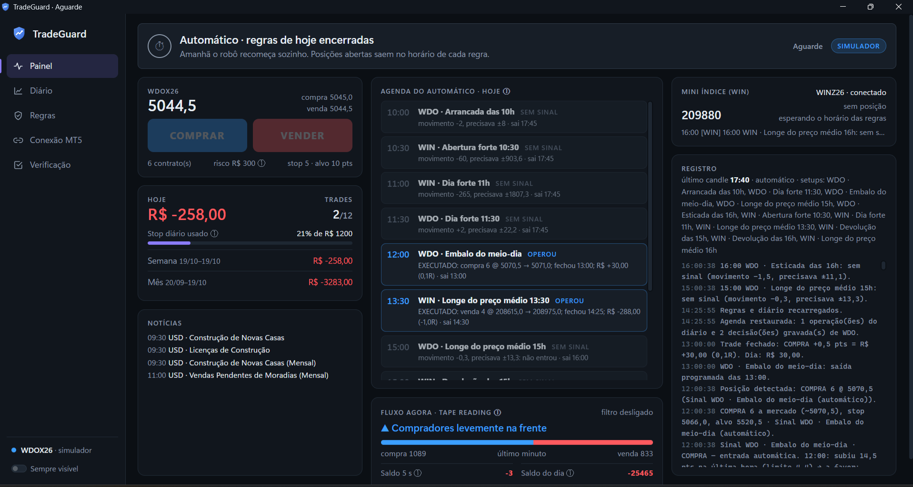
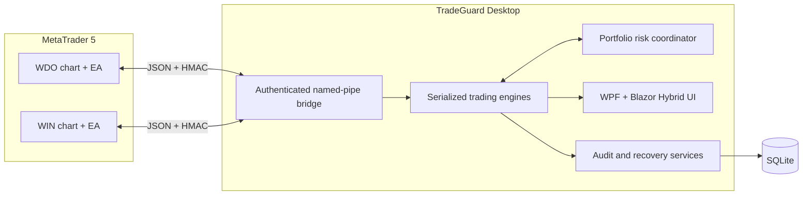
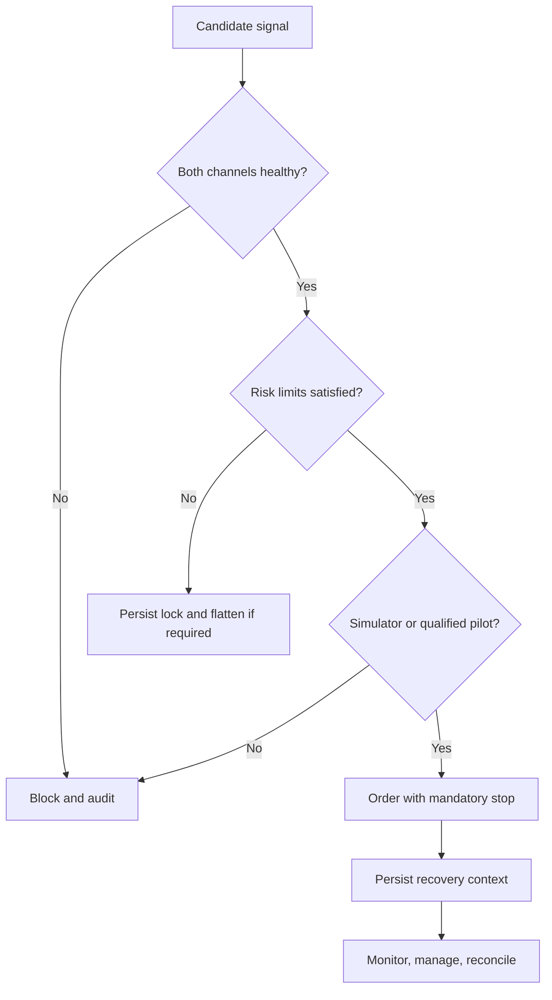

# TradeGuard

[](https://github.com/johnnysb160/TradeGuard-Showcase/actions/workflows/ci.yml)


TradeGuard is a Windows risk-and-execution platform for B3 mini futures. It combines a WPF + Blazor Hybrid desktop application, a deterministic trading engine, an authenticated named-pipe bridge, and an MQL5 Expert Advisor for MetaTrader 5.

> **Simulation-first project.** The public snapshot defaults to simulator-safe behavior and is published as an engineering case study, not as financial advice or a promise of trading performance. Broker accounts, credentials, live data, logs, and private research datasets are not included.

## Product snapshot



The dashboard keeps price, portfolio risk, scheduled rules, market flow, positions, news, and the audit trail visible on one screen. The color system avoids green: blue represents buy/profit, red represents sell/loss, amber represents attention, and violet represents interface state.

## The engineering problem

Automating order execution is the easy part. The hard part is guaranteeing that every decision remains bounded, auditable, recoverable after restarts, and unable to silently promote a simulated strategy into real-money operation.

TradeGuard treats those constraints as the product:

- **Deterministic decision engine** with one serialized event queue per instrument.
- **Portfolio-level risk coordination** across WDO and WIN, including floating P&L.
- **Authenticated bridge protocol** using HMAC-SHA256, session nonces, sequence numbers, and user-only named-pipe ACLs.
- **Independent fail-safes** in both the .NET application and MQL5 Expert Advisor.
- **Crash recovery** for position context, trade reconstruction, stops, and scheduled decisions.
- **Causal replay and parity audits** comparing live decisions with reproducible historical inputs.
- **Explicit real-account gate** requiring operational evidence; configuration alone cannot enable it.
- **Simulation-only execution test** excluded from performance statistics.

## Architecture



[Read the architecture case study](docs/architecture.md)

## Technology

- .NET 10, WPF, Blazor Hybrid, WebView2
- C# domain model and hosted services
- MQL5 Expert Advisor
- EF Core with SQLite
- Windows named pipes, HMAC-SHA256, DPAPI
- xUnit automated tests

## Repository structure

```text
src/TradeGuard.Domain/         Pure rules, risk, signals, replay, statistics
src/TradeGuard.Bridge/         Framing, HMAC protocol, named-pipe server
src/TradeGuard.Infrastructure/ SQLite persistence and DPAPI secret storage
src/TradeGuard.UI/             Engines, orchestration, Razor UI
src/TradeGuard.Desktop/        WPF host and Windows integration
mql5/                          MetaTrader 5 Expert Advisor
tests/TradeGuard.Tests/        Domain, risk, recovery, and parity tests
docs/                          Public architecture and security notes
```

## Build and test

Prerequisites: Windows 10/11 and the .NET 10 SDK. MetaTrader 5 is required only for live simulator integration, not for the automated test suite.

```powershell
dotnet restore TradeGuard.slnx
dotnet build TradeGuard.slnx --configuration Release --no-restore
dotnet test TradeGuard.slnx --configuration Release --no-build
```

To explore the desktop host locally:

```powershell
dotnet run --project src/TradeGuard.Desktop
```

Keep `AllowRealAccount` disabled and use a MetaTrader demo account. Never place broker credentials in this repository.

## Safety model



The MQL5 side refuses orders without stops, can reject real accounts independently, and performs an emergency close if the application disappears while a position is unprotected.

## What this repository intentionally excludes

- Broker account identifiers and credentials
- Trading logs, databases, decision files, and tick archives
- Private research datasets and operational evidence
- Machine-specific installation scripts and paths
- Any claim that backtests predict future returns

## Source availability

This repository is published for portfolio review. No open-source license is granted unless a license file is added later.

