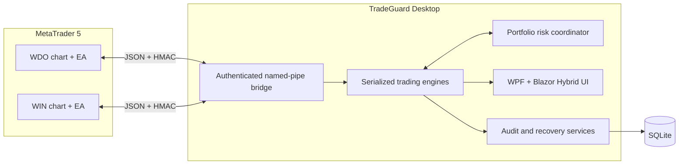
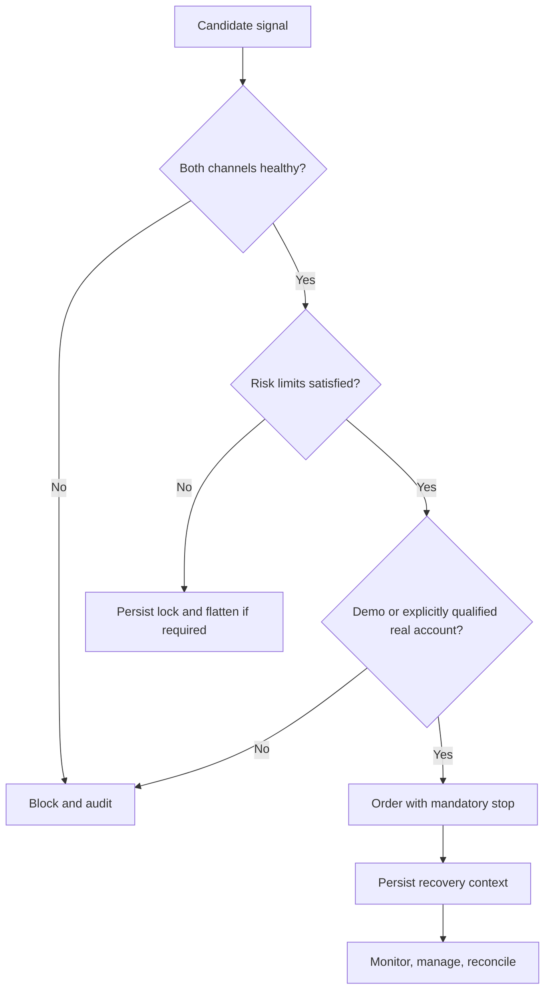

# TradeGuard

[](https://github.com/johnnysb160/TradeGuard-Showcase/actions/workflows/ci.yml)


TradeGuard is a real-operation risk and execution platform for B3 mini futures. It can open, modify, reduce, manage, and close WDO and WIN positions in MetaTrader 5 through an MQL5 Expert Advisor, while a .NET desktop application coordinates strategy decisions, operator commands, portfolio risk, recovery, and auditability.

Real-account execution is a first-class capability, protected by an explicit authorization and operational-qualification gate. The simulator is an additional environment for setup validation, failure drills, and safe rollout; it is not the definition of the product. The public snapshot contains no broker account, credentials, live market history, operational logs, or private research data and makes no claim of future trading performance.

## Product snapshot


The screenshot records one simulator session. The same operator dashboard is used to supervise terminal connectivity, the active account type, WDO/WIN prices, open positions, realized and floating P&L, daily risk consumption, scheduled strategies, economic news, tape-reading signals, and the chronological execution log.

## What the system does

TradeGuard covers the full operating cycle instead of stopping at signal generation:

1. **Connects to MetaTrader 5.** Per-instrument Expert Advisors stream quotes, candles, trades, book data, news, account state, positions, and execution reports through authenticated local pipes.
2. **Coordinates three operating modes.** In Assistant mode the operator enters and the system manages risk; in Semi-Auto it proposes and waits for confirmation; in Auto the approved strategy portfolio can execute without a click. Account authorization and automatic-strategy authorization are independent gates.
3. **Evaluates market and portfolio state.** Each WDO and WIN event is serialized, then checked against connectivity, broker and algo-trading health, audit storage, account type, current contract, spread, news windows, operating hours, open positions, and combined floating P&L.
4. **Executes protected orders.** Accepted entries carry a mandatory stop and target. The system can subsequently move protection, take partial exits, reduce excess size, or flatten the position.
5. **Manages the complete trade.** Break-even, stepped profit locks, fixed or previous-candle trailing stops, maximum holding time, pyramiding, controlled averaging, and scheduled exits all remain inside the original risk envelope.
6. **Closes the operational loop.** Trades, decisions, locks, settings, and recovery context are persisted. After a restart, TradeGuard reconciles its state with MT5 history and reconstructs missing records without duplicating positions.

## Product depth

| Area | Capabilities |
|---|---|
| Execution | Real or demo MT5 accounts; buy/sell; stop-loss and take-profit; modify, partial reduce, and close-all commands |
| Strategy portfolio | Eleven scheduled WDO/WIN rules using day movement, 30/60-minute movement, distance from the daily mean, ADR-normalized thresholds, and defined exit times |
| Decision modes | Operator-led Assistant, one-click Semi-Auto confirmation, and separately qualified Auto execution |
| Market reading | Times & Trades aggressor balance, absorption detection, book depth, candle history, daily levels, trend, spread, and high-impact news windows |
| Position management | Risk-based sizing, break-even, partials, profit-lock steps, trailing stops, time exits, pyramiding, and constrained averaging |
| Risk governance | Mandatory stops; daily, weekly, and monthly loss limits; daily target; profit give-back; trade and consecutive-loss caps; cooldown; forced end-of-day flattening |
| Operations | WDO/WIN portfolio coordination, authenticated IPC, terminal discovery, health checks, persistent day locks, reconnect/recovery, backups, and an operator verification screen |
| Evidence | Automatic journal, equity curve, statistics per setup, candle replay, live-vs-replay parity checks, decision traces, and shadow-only probabilistic learning |

## The engineering problem

Sending an order is straightforward. The difficult part is proving that every real-money decision is bounded, observable, recoverable after restarts, and unable to bypass the operator's risk policy.

TradeGuard treats those constraints as the product:

- **Deterministic decision engine** with one serialized event queue per instrument.
- **Portfolio-level risk coordination** across WDO and WIN, including floating P&L.
- **Authenticated bridge protocol** using HMAC-SHA256, session nonces, sequence numbers, and user-only named-pipe ACLs.
- **Independent fail-safes** in both the .NET application and MQL5 Expert Advisor.
- **Crash recovery** for position context, trade reconstruction, stops, and scheduled decisions.
- **Causal replay and parity audits** comparing live decisions with reproducible historical inputs.
- **Explicit real-account gate** requiring operational evidence; a configuration edit alone cannot enable it.
- **Separated rollout gates:** simulator evidence can qualify a strategy without silently granting authority over a real account.
- **Anti-tilt settings policy:** tighter limits apply immediately, while risk-increasing changes wait until the next trading session.

## Architecture



[Read the architecture case study](docs/architecture.md)

## Technology

- .NET 10, WPF, Blazor Hybrid, WebView2
- C# domain model and hosted services
- MQL5 Expert Advisor
- EF Core with SQLite
- Windows named pipes, HMAC-SHA256, DPAPI
- xUnit automated tests

## Repository structure

```text
src/TradeGuard.Domain/         Pure rules, risk, signals, replay, statistics
src/TradeGuard.Bridge/         Framing, HMAC protocol, named-pipe server
src/TradeGuard.Infrastructure/ SQLite persistence and DPAPI secret storage
src/TradeGuard.UI/             Engines, orchestration, Razor UI
src/TradeGuard.Desktop/        WPF host and Windows integration
mql5/                          MetaTrader 5 Expert Advisor
tests/TradeGuard.Tests/        Domain, risk, recovery, and parity tests
docs/                          Public architecture and security notes
```

## Build and test

Prerequisites: Windows 10/11 and the .NET 10 SDK. MetaTrader 5 is required for terminal integration with demo or real accounts, but not for the automated test suite.

```powershell
dotnet restore TradeGuard.slnx
dotnet build TradeGuard.slnx --configuration Release --no-restore
dotnet test TradeGuard.slnx --configuration Release --no-build
```

To explore the desktop host locally:

```powershell
dotnet run --project src/TradeGuard.Desktop
```

For local evaluation, keep `AllowRealAccount` disabled and use a MetaTrader demo account. Real-account operation exists in the product but must only be enabled after its qualification checklist and with credentials supplied outside the repository.

## Safety model



The MQL5 side refuses orders without stops, can reject real accounts independently, and performs an emergency close if the application disappears while a position is unprotected.

## What this repository intentionally excludes

- Broker account identifiers and credentials
- Trading logs, databases, decision files, and tick archives
- Private research datasets and operational evidence
- Machine-specific installation scripts and paths
- Any claim that backtests predict future returns

## Source availability

This repository is published for portfolio review. No open-source license is granted unless a license file is added later.
