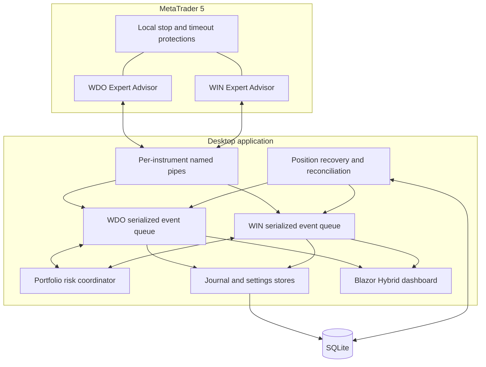

# Architecture case study

## Design objective

TradeGuard is designed around a stronger invariant than “the strategy generated a signal”: no demo or real-account order may bypass health checks, portfolio limits, mandatory protection, auditability, and account-authorization gates.

## Runtime components

## Protocol

Each line contains JSON plus an HMAC-SHA256 signature. The initial handshake exchanges nonces and derives a session key from the local master key. Subsequent frames require a strictly increasing sequence number, reducing replay risk. The pipe ACL is restricted to the current Windows user and denies remote access.

## Concurrency model

Every market message, UI command, timer tick, configuration reload, and report request enters a single channel per instrument. That design prevents a rule evaluation and a risk update from racing each other. A portfolio coordinator adds cross-instrument health and floating-loss checks.

## Recovery

Before an order is sent, TradeGuard persists the setup, initial risk, stop, target, and position correlation context. On restart it reconciles that context with the terminal history and reconstructs missing closed trades without duplicating position identifiers.

## Defense in depth

| Layer | Responsibility |
|---|---|
| Domain | Entry limits, daily/weekly/monthly locks, sizing, managed exits |
| Portfolio coordinator | Combined WDO/WIN health and floating risk |
| Bridge | Authentication, sequencing, timeouts, user-only transport |
| Expert Advisor | Mandatory stops, account gate, emergency close |
| Persistence | Versioned settings, day locks, journal, recovery context |
| UI | Clear operating state; no hidden safety bypass |

## Real-account authority

The bridge and Expert Advisor implement actual broker-side order operations: open, modify stop/target, reduce, and close. Real execution is intentionally a separate permission from strategy automation. TradeGuard requires an allowed account type, persisted operational evidence, healthy WDO/WIN channels, available audit storage, and the same risk checks used in simulation before an order can reach MT5. The Expert Advisor independently rejects unauthorized real-account commands and keeps local emergency protections active if the desktop process disappears.

## Research discipline

The system separates candidate research from operational authorization. Historical replay, chronological splits, live parity checks, and a shadow-only probabilistic filter may produce evidence, but they cannot silently enable real-money trading or increase risk.

## Trade-offs

- A Windows-only host enables tight MT5 and DPAPI integration but reduces platform portability.
- Serialized queues prioritize correctness and auditability over maximum throughput, which is appropriate for the instruments and rule cadence.
- SQLite keeps local operation simple; it also makes backup, disk-health checks, and corruption containment part of the application contract.
